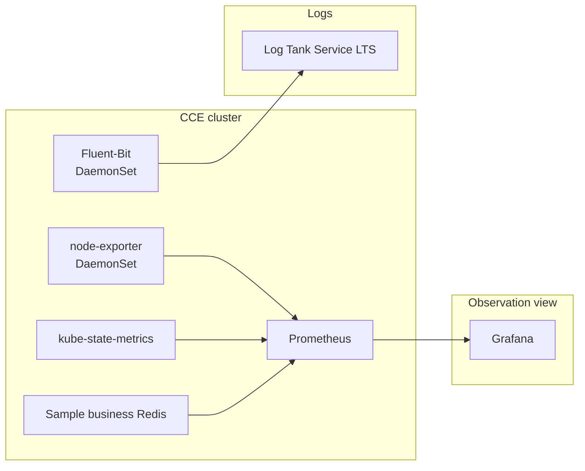

# deterministic-operations-container-observability

[](LICENSE)
[](https://support.huaweicloud.com/intl/en-us/)
[](#)
> Container observability collection pipeline: deploy metric and log collectors on Cloud Container Engine (CCE) with declarative Kubernetes manifests, aggregate them in Prometheus for unified observability, and include prebuilt dashboards.

## 1. Overview

This practice provides a set of container observability collector manifests that can be deployed directly to Huawei Cloud Cloud Container Engine (CCE). They are organized in DaemonSet / Service / Sidecar / combined one-command startup modes, collecting node and container metrics, cluster object metrics, and container logs, which are aggregated by Prometheus and accompanied by prebuilt Grafana dashboards. It is intended for DevOps / container platform / operations engineers and can serve as a reference implementation and production template for a container observability foundation.

### Core capabilities

- **Metric collection**: node-exporter (DaemonSet, node and container metrics) + kube-state-metrics (cluster object metrics) + unified Prometheus scraping
- **Log collection**: Fluent-Bit DaemonSet tails container logs and parses Kubernetes metadata; in production it can connect to Log Tank Service (LTS)
- **Three deployment modes**: DaemonSet / Service / Sidecar are clearly structured for teaching purposes; choose according to business needs
- **Prebuilt dashboards**: node overview and Redis business metrics Grafana dashboard JSON work out of the box
- **One-Command**: `quickstart-all-in-one.yaml` deploys all collectors with a single command

---

## 2. Table of Contents

- [1. Overview](#1-overview)
- [2. Table of Contents](#2-table-of-contents)
- [3. Architecture Diagram](#3-architecture-diagram)
- [4. Highlights](#4-highlights)
- [5. Cloud Services Used](#5-cloud-services-used)
- [6. Prerequisites](#6-prerequisites)
- [7. Quick Start](#7-quick-start)
- [8. Step-by-Step Deployment](#8-step-by-step-deployment)
- [9. Usage / Verification](#9-usage--verification)
- [10. Cleanup](#10-cleanup)
- [11. Detailed Explanation](#11-detailed-explanation)
- [12. Dependencies](#12-dependencies)
- [13. FAQ / Troubleshooting](#13-faq--troubleshooting)
- [14. Contributing](#14-contributing)
- [15. License](#15-license)
- [16. Contact / Maintainers](#16-contact--maintainers)

---

## 3. Architecture Diagram



**Key component description**:
- node-exporter / kube-state-metrics: node and cluster object metric collection
- Prometheus: in-cluster metric aggregation and querying
- Fluent-Bit: container log collection (connects to LTS in production)
- Grafana: prebuilt dashboard visualization

See [`docs/architecture.md`](docs/architecture.md) for details.

---

## 4. Highlights

- **Collectors as code**: all delivered as versioned Kubernetes manifests, deployable with one command along with the business cluster and auditable
- **Three classic modes**: DaemonSet (platform-level collection) / Service (cluster-level aggregation) / Sidecar (business custom metrics)
- **Ready-to-use dashboards**: prebuilt node overview and Redis business panels
- **Gradual log onboarding**: stdout by default for verification, switch to Log Tank Service (LTS) with one command in production

---

## 5. Cloud Services Used

| Service | Purpose | Notes |
|---|---|---|
| Cloud Container Engine (CCE) | Managed Kubernetes cluster and node pool | Hosts collectors and business workloads |
| Virtual Private Cloud (VPC) | Network foundation | — |
| Container Image Repository (SWR) | Hosting custom collector images | Open-source images can also be pulled directly |
| Log Tank Service (LTS) | Log aggregation target (for production) | Log group / log stream pre-created |

> **Tip**: All services can be created with one command via this repository's Terraform; for cleanup, see [Section 10 "Cleanup"](#10-cleanup).

---

## 6. Prerequisites

| Item | Requirement | Notes |
|---|---|---|
| **Account** | Huawei Cloud account opened and real-name authenticated | Personal or enterprise accounts are both acceptable |
| **Permissions** | IAM **Tenant Administrator** or equivalent permissions | For creating VPC / CCE / LTS and other resources |
| **Region** | `cn-north-4` recommended | Cross-region service availability may differ |
| **Terraform** | `>= 1.5.0` | IaC deployment tool |
| **huaweicloud Provider** | `>= 1.70.0` | Huawei Cloud Terraform Provider |
| **kubectl** | `>= 1.28` | K8s cluster management |
| **SSH key pair** | Created in the ECS console | For CCE node login; enter the name during deployment |
| **AK/SK** | Obtain Access Key ID and Secret Access Key from the Huawei Cloud "My Credentials" page and fill them into the deployment script | **Do not** write credentials into any code or configuration files |

---

## 7. Quick Start

### One-click deployment (recommended)

```bash
# 1. Clone this repository
git clone https://github.com/huaweicloud-samples/deterministic-operations-container-observability.git deterministic-operations-container-observability
cd deterministic-operations-container-observability

# 2. Prepare Huawei Cloud AK/SK (see Prerequisites)
export HW_ACCESS_KEY="<your-access-key>"
export HW_SECRET_KEY="<your-secret-key>"

# 3. Create infrastructure (VPC / CCE / LTS / SWR)
cd infra
cp terraform.tfvars.example terraform.tfvars
# Edit terraform.tfvars: fill in node_keypair_name, etc.
terraform init
terraform apply -auto-approve

# 4. Connect to the cluster and deploy collectors
cd ../scripts
./deploy-manifests.sh
./deploy-manifests.sh --redis   # Optional: sample traffic
./verify.sh
```

> **Complete steps and expected output for each step**: see [Section 8 "Step-by-Step Deployment"](#8-step-by-step-deployment).

---

## 8. Step-by-Step Deployment

### Step 1: Initialize the working directory

```bash
cd infra
terraform init
```

**Expected output**: `Terraform has been successfully initialized!`

### Step 2: Preview resource changes

```bash
terraform plan
```

**Expected output**: `Plan: N to add, 0 to change, 0 to destroy.`

### Step 3: Execute deployment

```bash
terraform apply -auto-approve
```

**Expected output**: `Apply complete! Resources: N added, 0 changed, 0 destroyed.` and lists outputs such as cluster endpoints and LTS resource names.

### Step 4: Obtain kubeconfig and connect to the cluster

Download kubeconfig from the CCE console "Connection Information", then:

```bash
export KUBECONFIG=<path-to-kubeconfig>
kubectl get nodes
```

**Expected output**: at least one `Ready` node.

### Step 5: Deploy collectors

```bash
cd ../scripts
./deploy-manifests.sh
```

**Expected output**: namespace / RBAC / collector manifests applied successfully, and `kubectl get pods -n observability` shows Running.

### Step 6: Verify

```bash
./verify.sh
```

**Expected output**: all collectors `Running`, node-exporter `/metrics` returns HTTP 200.

---

## 9. Usage / Verification

> **After deployment, follow these steps to verify that the business functionality works before considering the delivery complete.**

### Verification 1: Collector Pod status

```bash
kubectl get pods -n observability -o wide
```

**Expected output**: node-exporter / kube-state-metrics / prometheus / fluent-bit are all `Running`.

### Verification 2: node-exporter /metrics is accessible

```bash
NODE_IP=$(kubectl get nodes -o jsonpath='{.items[0].status.addresses[?(@.type=="InternalIP")].address}')
curl -s -o /dev/null -w '%{http_code}\n' --max-time 5 "http://${NODE_IP}:9100/metrics"
```

**Expected output**: `200`.

### Verification 3: Prometheus endpoint exists

```bash
kubectl get svc prometheus -n observability
```

**Expected output**: Service `prometheus` exists and `CLUSTER-IP` is visible.

### Verification 4: Sample business metrics (optional, after deploying --redis)

```bash
kubectl exec -n observability deploy/redis-demo -c redis -- redis-cli ping
```

**Expected output**: `PONG`.

Then you can see `redis_up 1` in the Redis exporter's `/metrics`.

### Verification 5: Log collection (Fluent-Bit)

```bash
kubectl logs -n observability -l k8s-app=fluent-bit --tail=5
```

**Expected output**: JSON lines of container logs output by Fluent-Bit.

---

## 10. Cleanup

```bash
# 1. Clean up in-cluster collectors
cd scripts
./deploy-manifests.sh --clean

# 2. Release cloud resources
cd ../infra
terraform destroy -auto-approve
```

**Expected output**: `Destroy complete! Resources: N destroyed.`

> **Avoid leftover resources**: If additional resources were created in the console (such as a Grafana ELB or manually uploaded images), release them manually; shared resources (NAT / VPC etc. shared with other tasks in the account) will not be affected.

---

## 11. Detailed Explanation

### Workflow

1. Terraform creates the VPC / CCE / LTS / SWR infrastructure.
2. `deploy-manifests.sh` deploys collector manifests: node-exporter (DaemonSet), kube-state-metrics (Deployment + Service), Prometheus (Deployment + Service), Fluent-Bit (DaemonSet).
3. Prometheus discovers and scrapes annotated exporters via Service discovery; Fluent-Bit tails container logs.
4. Grafana (optional) imports prebuilt dashboards to display metrics.

### Configuration items

| Variable | Default | Description |
|---|---|---|
| `region` | `cn-north-4` | Huawei Cloud region |
| `project_name` | `container-obs` | Resource naming prefix |
| `node_flavor` | `s6.large.2` | CCE node flavor |
| `node_count` | `1` | Number of nodes |
| `node_keypair_name` | (required) | Name of an existing SSH key pair |
| `lts_ttl_days` | `7` | Log retention days |

### Collector manifests

| Manifest | Mode | Description |
|---|---|---|
| `src/manifests/metrics/node-exporter-daemonset.yaml` | DaemonSet | Node/container metrics |
| `src/manifests/metrics/kube-state-metrics-deployment.yaml` | Service | Cluster object metrics |
| `src/manifests/metrics/prometheus-service.yaml` | Service | Prometheus aggregation |
| `src/manifests/logs/fluent-bit-daemonset.yaml` | DaemonSet | Container log collection |
| `src/manifests/sidecar/statsd-sidecar-example.yaml` | Sidecar | Business custom metrics example |
| `src/manifests/sample-traffic/redis-demo.yaml` | — | Sample traffic |
| `src/manifests/quickstart/quickstart-all-in-one.yaml` | Combined | One-click deployment |

---

## 12. Dependencies

### Main dependencies

| Name | Version | Purpose |
|---|---|---|
| Terraform | `>= 1.5.0` | IaC orchestration |
| huaweicloud Provider | `>= 1.70.0` | Huawei Cloud resources |
| node-exporter image | `v1.8.2` | Node metric collection |
| kube-state-metrics image | `v2.13.0` | Cluster object metrics |
| Prometheus image | `v2.53.0` | Metrics aggregation |
| Fluent-Bit image | `2.2.0` | Log collection |

---

## 13. FAQ / Troubleshooting

### Q1: What if deployment reports "insufficient permissions"?

**A**: Confirm the account has IAM **Tenant Administrator** permissions, or at least sub-service administrator permissions such as `VPC Administrator`, `CCE Administrator`, and `LTS Administrator`.

### Q2: Node times out pulling open-source images?

**A**: Confirm the subnet where the nodes reside has outbound network access (NAT / EIP); if a particular registry is slow, mirror the image through SWR and use the image address within the `project_name` organization.

### Q3: node-exporter /metrics cannot be opened?

**A**: Confirm the Pod is Running (`kubectl get pods -n observability`); the test machine and nodes have network connectivity; and the security group allows port 9100.

### Q4: Fluent-Bit produces no output?

**A**: Output goes to stdout by default; confirm `kubectl logs -n observability -l k8s-app=fluent-bit` shows logs. When the container runtime is containerd, the `/var/lib/docker` path does not exist, which is fine (the tail directory is `/var/log/containers`).

### Troubleshooting checklist

| Symptom | Possible cause | Troubleshooting method |
|---|---|---|
| Collector Pod Pending | Node taint / insufficient resources | `kubectl describe pod -n observability` |
| Prometheus has no targets | Service discovery did not match | `kubectl port-forward svc/prometheus 9090:9090` → Targets |
| Nodes cannot access the internet | No NAT / EIP | Configure a NAT gateway + SNAT on the subnet |
| CCE node creation fails | Flavor / AZ mismatch | Adjust flavor / AZ according to the node pool error message |

---

## 14. Contributing

Issues and PRs are welcome. Please follow this process:

1. **Issue**: describe the problem / suggestion (include reproduction commands, expected / actual output, screenshots)
2. **PR**: create a feature branch from `main`; run `terraform validate` and `terraform fmt -check` before committing

---

## 15. License

This practice is released under the **MIT No Attribution** license. See [`LICENSE`](LICENSE) in the repository root.

```
MIT No Attribution

Copyright (c) Huawei Cloud

Permission is hereby granted, free of charge, to any person obtaining a copy
of this software... (no attribution required)
```

---

## 16. Contact / Maintainers
| Item | Content |
|---|---|
| **Creator** | [dgc-git](https://github.com/dgc-git) |
| **Maintainer** | [dgc-git](https://github.com/dgc-git) |
| **Contact** | GitHub Issues / PR (see [Section 14](#14-contributing)) |
