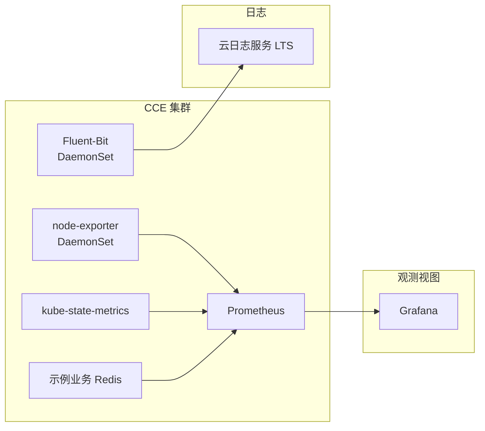

# deterministic-operations-container-observability

[](LICENSE)
[](https://support.huaweicloud.com/intl/en-us/)
[](#)
> 容器可观测性采集链路：用声明式 Kubernetes 清单在云容器引擎（CCE）上部署指标与日志采集器，汇聚到 Prometheus 统一观测并配预置仪表盘。
---

## 1. 简介 / Overview

本实践提供一套可直接部署到华为云云容器引擎（CCE）的容器观测采集器清单——按 DaemonSet / Service / Sidecar / 组合一键启动等模式组织，采集节点与容器指标、集群对象指标、容器日志，并由 Prometheus 统一汇聚、配套预置 Grafana 仪表盘。面向 DevOps / 容器平台 / 运维工程师，可作为容器可观测基座的参考实现与生产模板。

### 核心能力

- **指标采集**：node-exporter（DaemonSet，节点与容器指标）+ kube-state-metrics（集群对象指标）+ Prometheus 统一抓取
- **日志采集**：Fluent-Bit DaemonSet，tail 容器日志并解析 Kubernetes 元数据，生产可对接云日志服务（LTS）
- **三种部署模式**：DaemonSet / Service / Sidecar 教学形态清晰，按业务取舍
- **预置仪表盘**：节点概览、Redis 业务指标 Grafana dashboard JSON 开箱即用
- **One-Command**：`quickstart-all-in-one.yaml` 一条命令部署全部采集器

---

---

## 2. 目录

- [1. 简介 / Overview](#1-简介--overview)
- [2. 目录](#2-目录)
- [3. 架构图](#3-架构图)
- [4. 方案亮点](#4-方案亮点)
- [5. 涉及云服务](#5-涉及云服务)
- [6. 前置条件](#6-前置条件)
- [7. 快速开始](#7-快速开始)
- [8. 分步部署](#8-分步部署)
- [9. 使用方法 / 验证](#9-使用方法--验证)
- [10. 清理资源](#10-清理资源)
- [11. 详细说明](#11-详细说明)
- [12. 依赖](#12-依赖)
- [13. FAQ / 故障排除](#13-faq--故障排除)
- [14. 贡献指南](#14-贡献指南)
- [15. 许可证](#15-许可证)
- [16. 联系方式 / 维护者](#16-联系方式--维护者)

---

---

## 3. 架构图



**关键组件说明**：
- node-exporter / kube-state-metrics：节点与集群对象指标采集
- Prometheus：集群内指标汇聚与查询
- Fluent-Bit：容器日志采集（生产对接 LTS）
- Grafana：预置仪表盘可视化

详见 [`docs/architecture.md`](docs/architecture.md)。

---

---

## 4. 方案亮点

- **采集器即代码**：全部以 Kubernetes 清单版本化交付，可随业务集群一键部署、可审计
- **经典三模式**：DaemonSet（平台级采集）/ Service（集群级汇聚）/ Sidecar（业务自定义指标）
- **开箱即用仪表盘**：预置节点概览与 Redis 业务面板
- **可渐进接入日志**：默认 stdout 验证，生产一键切换云日志服务（LTS）

---

---

## 5. 涉及云服务

| 服务 | 用途 | 备注 |
|---|---|---|
| 云容器引擎（CCE） | 托管 Kubernetes 集群与节点池 | 承载采集器与业务 |
| 虚拟私有云（VPC） | 网络底座 | — |
| 容器镜像仓库（SWR） | 自定义采集器镜像托管 | 开源镜像亦可直拉 |
| 云日志服务（LTS） | 日志汇聚目标（生产对接） | 日志组 / 日志流已预建 |

> **提示**：所有服务均可通过本仓库的 Terraform 一键创建；如需清理，请参见 [第 10 节「清理资源」](#10-清理资源)。

---

---

## 6. 前置条件

| 项 | 要求 | 说明 |
|---|---|---|
| **账号** | 已开通华为云账号并完成实名认证 | 个人/企业账号均可 |
| **权限** | IAM **Tenant Administrator** 或等效权限 | 用于创建 VPC / CCE / LTS 等资源 |
| **Region** | 推荐 `cn-north-4` | 跨 region 可能涉及服务可用性差异 |
| **Terraform** | `>= 1.5.0` | IaC 部署工具 |
| **huaweicloud Provider** | `>= 1.70.0` | 华为云 Terraform Provider |
| **kubectl** | `>= 1.28` | K8s 集群管理 |
| **SSH 密钥对** | ECS 控制台已创建 | CCE 节点登录，部署时填名称 |
| **AK/SK** | 在华为云『我的凭证』页面获取 Access Key ID 与 Secret Access Key，并填入部署脚本 | **不要**将凭据写入任何代码或配置文件 |

---

---

## 7. 快速开始

### 一键部署（推荐）

```bash
# 1. 克隆本仓库
git clone https://github.com/huaweicloud-samples/deterministic-operations-container-observability.git deterministic-operations-container-observability
cd deterministic-operations-container-observability

# 2. 准备华为云 AK/SK（参见 前置条件）
export HW_ACCESS_KEY="<your-access-key>"
export HW_SECRET_KEY="<your-secret-key>"

# 3. 创建基础设施（VPC / CCE / LTS / SWR）
cd infra
cp terraform.tfvars.example terraform.tfvars
# 编辑 terraform.tfvars：填入 node_keypair_name 等
terraform init
terraform apply -auto-approve

# 4. 连接集群并部署采集器
cd ../scripts
./deploy-manifests.sh
./deploy-manifests.sh --redis   # 可选：示例流量
./verify.sh
```

> **完整步骤与每步预期输出**：参见 [第 8 节「分步部署」](#8-分步部署)。

---

---

## 8. 分步部署

### 步骤 1：初始化工作目录

```bash
cd infra
terraform init
```

**预期输出**：`Terraform has been successfully initialized!`

### 步骤 2：预演资源变更

```bash
terraform plan
```

**预期输出**：`Plan: N to add, 0 to change, 0 to destroy.`

### 步骤 3：执行部署

```bash
terraform apply -auto-approve
```

**预期输出**：`Apply complete! Resources: N added, 0 changed, 0 destroyed.` 并列出集群端点、LTS 资源名等 output。

### 步骤 4：获取 kubeconfig 并连接集群

从 CCE 控制台「连接信息」下载 kubeconfig，然后：

```bash
export KUBECONFIG=<path-to-kubeconfig>
kubectl get nodes
```

**预期输出**：至少一个 `Ready` 节点。

### 步骤 5：部署采集器

```bash
cd ../scripts
./deploy-manifests.sh
```

**预期输出**：命名空间 / RBAC / 各采集器清单 apply 成功，`kubectl get pods -n observability` 显示 Running。

### 步骤 6：验证

```bash
./verify.sh
```

**预期输出**：所有采集器 `Running`，node-exporter `/metrics` HTTP 200。

---

---

## 9. 使用方法 / 验证

> **部署完成后请按本节步骤自行验证，确认业务功能可用，方可视为交付完成。**

### 验证 1：采集器 Pod 状态

```bash
kubectl get pods -n observability -o wide
```

**预期输出**：node-exporter / kube-state-metrics / prometheus / fluent-bit 均 `Running`。

### 验证 2：node-exporter /metrics 可访问

```bash
NODE_IP=$(kubectl get nodes -o jsonpath='{.items[0].status.addresses[?(@.type=="InternalIP")].address}')
curl -s -o /dev/null -w '%{http_code}\n' --max-time 5 "http://${NODE_IP}:9100/metrics"
```

**预期输出**：`200`。

### 验证 3：Prometheus 端点存在

```bash
kubectl get svc prometheus -n observability
```

**预期输出**：Service `prometheus` 存在，`CLUSTER-IP` 可见。

### 验证 4：示例业务指标（可选，部署 --redis 后）

```bash
kubectl exec -n observability deploy/redis-demo -c redis -- redis-cli ping
```

**预期输出**：`PONG`。

然后可在 Redis exporter 的 `/metrics` 中看到 `redis_up 1`。

### 验证 5：日志采集（Fluent-Bit）

```bash
kubectl logs -n observability -l k8s-app=fluent-bit --tail=5
```

**预期输出**：Fluent-Bit 输出的容器日志 JSON 行。

---

---

## 10. 清理资源

```bash
# 1. 清理集群内采集器
cd scripts
./deploy-manifests.sh --clean

# 2. 释放云上资源
cd ../infra
terraform destroy -auto-approve
```

**预期输出**：`Destroy complete! Resources: N destroyed.`

> **避免资源残留**：若在控制台额外创建了资源（如 Grafana ELB、手工上传镜像），需手动释放；公共资源（账号内其他任务共享的 NAT / VPC 等）不会被影响。

---

---

## 11. 详细说明

### 工作流程

1. Terraform 创建 VPC / CCE / LTS / SWR 基础设施。
2. `deploy-manifests.sh` 部署采集器清单：node-exporter（DaemonSet）、kube-state-metrics（Deployment + Service）、Prometheus（Deployment + Service）、Fluent-Bit（DaemonSet）。
3. Prometheus 通过 Service 发现抓取带注解的 exporter；Fluent-Bit tail 容器日志。
4. Grafana（可选）导入预置仪表盘展示指标。

### 配置项

| 变量 | 默认值 | 说明 |
|---|---|---|
| `region` | `cn-north-4` | 华为云区域 |
| `project_name` | `container-obs` | 资源命名前缀 |
| `node_flavor` | `s6.large.2` | CCE 节点规格 |
| `node_count` | `1` | 节点数 |
| `node_keypair_name` | （必填） | 已有 SSH 密钥对名称 |
| `lts_ttl_days` | `7` | 日志保留天数 |

### 采集器清单

| 清单 | 模式 | 说明 |
|---|---|---|
| `src/manifests/metrics/node-exporter-daemonset.yaml` | DaemonSet | 节点/容器指标 |
| `src/manifests/metrics/kube-state-metrics-deployment.yaml` | Service | 集群对象指标 |
| `src/manifests/metrics/prometheus-service.yaml` | Service | Prometheus 汇聚 |
| `src/manifests/logs/fluent-bit-daemonset.yaml` | DaemonSet | 容器日志采集 |
| `src/manifests/sidecar/statsd-sidecar-example.yaml` | Sidecar | 业务自定义指标示例 |
| `src/manifests/sample-traffic/redis-demo.yaml` | — | 示例流量 |
| `src/manifests/quickstart/quickstart-all-in-one.yaml` | 组合 | 一键部署 |

---

---

## 12. 依赖

### 主要依赖

| 名称 | 版本 | 用途 |
|---|---|---|
| Terraform | `>= 1.5.0` | IaC 编排 |
| huaweicloud Provider | `>= 1.70.0` | 华为云资源 |
| node-exporter 镜像 | `v1.8.2` | 节点指标采集 |
| kube-state-metrics 镜像 | `v2.13.0` | 集群对象指标 |
| Prometheus 镜像 | `v2.53.0` | 指标汇聚 |
| Fluent-Bit 镜像 | `2.2.0` | 日志采集 |

---

---

## 13. FAQ / 故障排除

### Q1：部署时提示「权限不足」怎么办？

**A**：确认账号具备 IAM **Tenant Administrator** 权限，或至少包含 `VPC Administrator`、`CCE Administrator`、`LTS Administrator` 等子服务管理员权限。

### Q2：节点拉取开源镜像超时？

**A**：确认节点所在子网具备出网能力（NAT / EIP）；个别镜像仓库访问慢时可在 SWR 中转后改用 `project_name` 组织内镜像地址。

### Q3：node-exporter /metrics 打不开？

**A**：确认 Pod 处于 Running（`kubectl get pods -n observability`）；测试机与节点网络互通；安全组放行 9100。

### Q4：Fluent-Bit 没有输出？

**A**：默认输出到 stdout，确认 `kubectl logs -n observability -l k8s-app=fluent-bit` 有日志；容器运行时为 containerd 时 `/var/lib/docker` 路径不存在，不影响（tail 目录为 `/var/log/containers`）。

### 故障排查清单

| 现象 | 可能原因 | 排查方法 |
|---|---|---|
| 采集器 Pod Pending | 节点 taint / 资源不足 | `kubectl describe pod -n observability` |
| Prometheus 无 target | Service 发现未匹配 | `kubectl port-forward svc/prometheus 9090:9090` → Targets |
| 节点无法出网 | 无 NAT / EIP | 子网配置 NAT 网关 + SNAT |
| CCE 节点创建失败 | 规格 / AZ 不匹配 | 对照节点池报错信息调整 flavor / AZ |

---

---

## 14. 贡献指南

欢迎提交 Issue 与 PR。请遵循以下流程：

1. **Issue**：描述问题 / 建议（含复现命令、预期 / 实际输出、截图）
2. **PR**：基于 `main` 分支新建 feature 分支；提交前运行 `terraform validate` 与 `terraform fmt -check`

---

---

## 15. 许可证

本实践采用 **MIT No Attribution** 许可证发布。详见仓库根目录 [`LICENSE`](LICENSE) 文件。

```
MIT No Attribution

Copyright (c) Huawei Cloud

Permission is hereby granted, free of charge, to any person obtaining a copy
of this software... (no attribution required)
```

---

---

## 16. 联系方式 / 维护者
| 项 | 内容 |
|---|---|
| **创建者** | [dgc-git](https://github.com/dgc-git) |
| **维护者** | [dgc-git](https://github.com/dgc-git) |
| **联系方式** | GitHub Issues / PR（见[第 14 节](#14-贡献指南)） |
