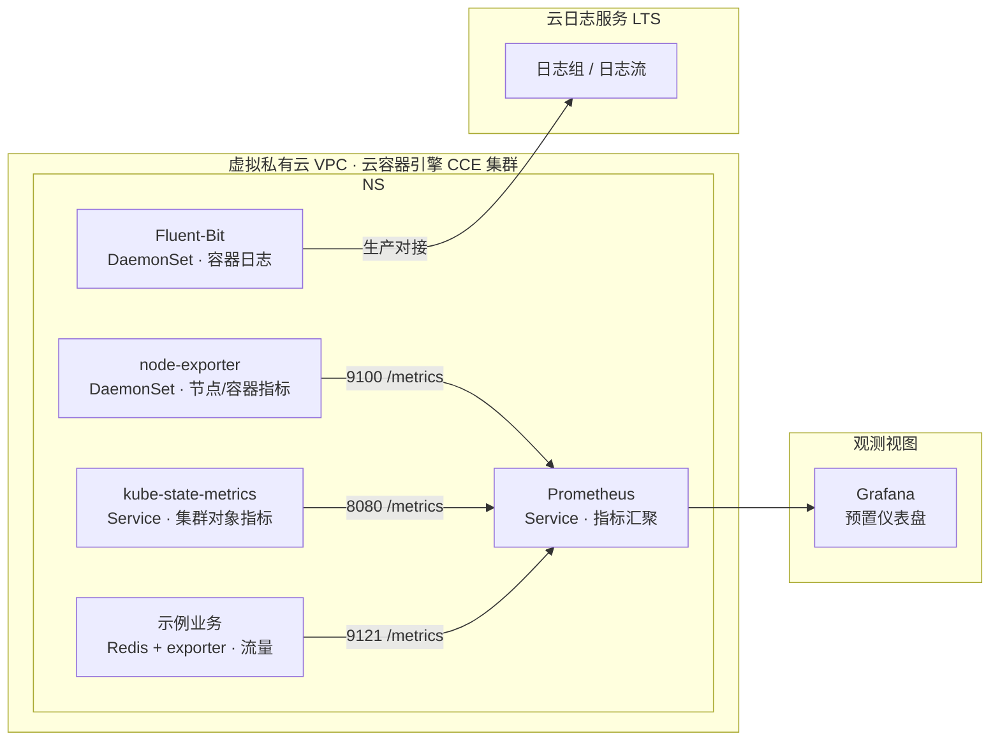

# 架构说明

本实践演示如何在华为云上构建**容器可观测性采集链路**：用声明式 Kubernetes 清单，把指标与日志采集器以 DaemonSet / Service / Sidecar 等部署模式挂载到云容器引擎（CCE）集群，将节点、容器与业务指标汇聚到 Prometheus 统一观测，并配套预置可视化仪表盘。

面向需要在云上容器集群内自管观测采集器的运维 / 平台团队——既要采集能力可编程、可版本化，又要能随业务集群一并交付。

## 架构总览

- **node-exporter（DaemonSet）**：每个节点一个采集器，采集节点 CPU / 内存 / 网络 / 磁盘与容器运行指标。
- **kube-state-metrics（Deployment + Service）**：采集集群对象（Deployment / Pod / Node / Namespace 等）状态指标。
- **Prometheus（Deployment + Service）**：统一抓取上述指标源与带 `prometheus.io/scrape` 注解的业务 exporter，形成集群级指标库。
- **Fluent-Bit（DaemonSet）**：每节点一个日志采集器，tail 容器标准输出，解析 Kubernetes 元数据；生产环境可对接云日志服务（LTS）或自建日志管道。
- **Grafana（可选自建）**：导入 `src/manifests/dashboards/` 下的预置仪表盘，对 Prometheus 指标做可视化。

## 关键组件

| 组件 | 职责 |
|---|---|
| 虚拟私有云（VPC） | 承载集群 / 节点 / 采集器网络 |
| 云容器引擎（CCE） | 托管 Kubernetes 集群与节点池 |
| 云日志服务（LTS） | 日志汇聚目标（生产对接） |
| Prometheus | 集群内指标汇聚与查询 |
| node-exporter / kube-state-metrics | 节点与集群对象指标采集 |
| Fluent-Bit | 容器日志采集与转发 |
| 容器镜像仓库（SWR） | 承载自定义采集器镜像（开源镜像亦可直拉） |

## 采集链路

1. **指标**：node-exporter / kube-state-metrics / 业务 exporter 暴露 `/metrics`；Prometheus 以 Service 发现自动抓取带注解的 Pod。
2. **日志**：Fluent-Bit DaemonSet tail `/var/log/containers/*.log`，过滤采集器自身日志，输出可对接 LTS / 自建管道。
3. **可视化**：导入预置 Grafana dashboard JSON，一键查看节点概览与业务（Redis 等）指标。

## 部署模式说明

本实践的采集器清单按 Kubernetes 经典三种部署模式组织，便于按业务取舍：

| 模式 | 对应清单 | 适用场景 |
|---|---|---|
| DaemonSet | `metrics/node-exporter*`、`logs/fluent-bit*` | 每节点必装的平台级采集 |
| Service / Deployment | `metrics/kube-state-metrics*`、`metrics/prometheus*` | 集群级指标汇聚与抓取 |
| Sidecar | `sidecar/statsd-sidecar-example.yaml` | 随业务 Pod 附带的自定义指标采集 |
| 组合一键启动 | `quickstart/quickstart-all-in-one.yaml` | 最小可信演示：一条命令部署全部采集器 |